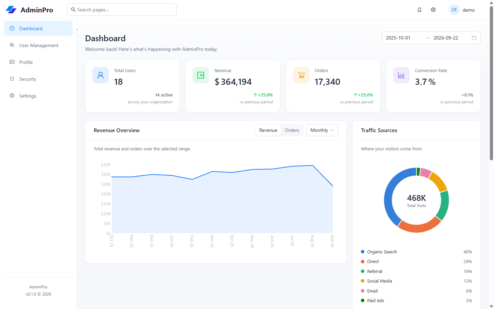

# Ant Design Admin Boilerplate

Vite + React 19 + Ant Design 5 admin starter with Pro Components. Authentication, users, profile, catalog, quotes, RBAC, media and attributes read from **pet-api**; dashboard and security stay mocked so the shell runs without the API for those screens.



## Highlights

- Responsive ProLayout shell with sidebar, mixed, and top navigation modes.
- Live template customizer for light/dark mode, preset or custom brand colors, and layout selection.
- JWT login against pet-api, backed by `sessionStorage`.
- User management (list, search, create, edit, delete) backed by `/api/v1/users`.
- Profile editing backed by `/api/v1/me`.
- Products, categories, tags, quotes, roles/permissions, media and attributes backed by pet-api.
- Dashboard metrics and security flows still use deterministic mock data.

## Requirements

- Node.js `^20.19` or `>=22.12` (required by Vite 8)
- pnpm 11 — `corepack enable` picks up the version pinned in `package.json`
- pet-api running on `http://localhost:8001` (see `pet-api/scripts/run_server.sh`)

## Getting started

```bash
cp .env.example .env   # VITE_API_BASE_URL, defaults to http://localhost:8001/api/v1
pnpm install
pnpm dev
```

Sign in with a real pet-api account. The default `.env.example` points at
`http://localhost:8001/api/v1`; CORS on pet-api already allows the Vite dev origin.

## Scripts

| Script              | What it does                       |
| ------------------- | ---------------------------------- |
| `pnpm dev`          | Vite dev server with HMR           |
| `pnpm build`        | Type-check, then build to `dist/`  |
| `pnpm preview`      | Serve the built `dist/` locally    |
| `pnpm deploy`       | Build, then deploy to Cloudflare   |
| `pnpm type-check`   | `tsc --noEmit`                     |
| `pnpm lint`         | ESLint over the repo               |
| `pnpm lint:fix`     | ESLint with autofix                |
| `pnpm format`       | Prettier, writing changes          |
| `pnpm format:check` | Prettier, check only (CI-friendly) |

`pnpm build` runs `tsc --noEmit` first, so type errors fail the build.

## Deploying to Cloudflare

`wrangler.jsonc` publishes `dist/` as Workers static assets with
`not_found_handling: "single-page-application"`, so react-router deep links such
as `/products/12` fall back to `index.html` instead of 404ing.

1. Log in once: `pnpm exec wrangler login` (or set `CLOUDFLARE_API_TOKEN` and
   `CLOUDFLARE_ACCOUNT_ID` in CI).
2. Point the build at the public API. `VITE_API_BASE_URL` is baked in at build
   time, so a production build needs the deployed pet-api origin, e.g. in
   `.env.production` (gitignored):
   ```bash
   VITE_API_BASE_URL=https://api.example.com/api/v1
   ```
3. Deploy: `pnpm deploy` (`pnpm build && wrangler deploy`).
4. Allow the portal origin in pet-api's CORS list (`CORS_ORIGINS`, a JSON array
   or comma-separated string), or login and every API call fail in the browser.

Media URLs are root-relative (`/local/...`); they resolve against the API origin,
so pet-api or the proxy in front of it must serve `/local/...` publicly. A custom
domain goes in `wrangler.jsonc` as a commented `routes` entry. To preview the
config without deploying, run `pnpm exec wrangler deploy --dry-run`.

## How it fits together

### Data flows in three layers

1. `src/api/client.ts` — the only module that touches `fetch`. It adds the Bearer token, serializes query params, parses the unified `ErrorResponse`, and clears the session on 401.
2. `src/api/modules/*.api.ts` — typed adapters: `auth.api.ts`, `user.api.ts`, `profile.api.ts`, `product.api.ts`, `category.api.ts`, `tag.api.ts`, `quote.api.ts`, `rbac.api.ts`, `media.api.ts` and `attribute.api.ts` call pet-api; `dashboard.api.ts` and `security.api.ts` still call `src/mocks/api.ts`.
3. Pages — import from `@/api/modules/*`, never from the mock or the client directly.

`user.api.ts` keeps the `PaginatedResponse<T>` contract and maps ProTable's `current/pageSize` to the API's `page/per_page`, so `useProTable` stays unchanged.

### Routes are declared once

`src/routes/routeDefinitions.tsx` holds `protectedRoutes` and `authRoutes`, all lazy-loaded. `src/routes/index.tsx` turns them into `<Routes>`; `src/layouts/MainLayout.tsx` independently reads `protectedRoutes` to build the sidebar. Adding a page means adding one entry to that file.

Paths are relative (`users`, not `/users`) because they nest under a layout route; `MainLayout` re-prefixes them with `/` for menu keys. `AuthGuard` wraps the whole authenticated branch and redirects to `/login` when there is no user.

### Auth uses a real JWT

`src/contexts/AuthContext.tsx` stores `access_token` and the `ApiUser` from `GET /me` in `sessionStorage`. Login posts `{ username, password }` to `/login`, saves the token, then fetches the profile. Logout and any 401 clear both keys. `UserName` in the header is `firstname + lastname`, falling back to `username`.

API user fields differ from the boilerplate's original demo shape: `username`, `firstname`, `lastname`, `roles[]`, and numeric `status` (`0` inactive, `1` active, `2` frozen). The user page uses those fields directly.

### Screens

Dashboard, User Management, Profile, Security and Settings are implemented. The pet-api surfaces add Products, Categories, Tags, Quotes, Access Control, Media and Attributes. `Role Management` and `Permission` are covered by the Access Control page (roles, permissions and assignment); pet-api has no role edit or delete endpoint.

### Local state, and what is deliberately not wired

`src/contexts/SettingsContext.tsx` holds branding and preferences in `localStorage` — theme, primary color, layout, logo, landing page, table density, and notification switches. The header's template customizer applies and persists appearance changes immediately. `GeneralTab` and `PreferencesTab` stage their form edits through `preview()` and only `save()` writes them; `cancel()` rolls back. Keys are validated on read by `readPreferences` in `src/utils/storage.ts`, which drops anything that is not a known key with the right type — a new persisted setting has to be added to `DEFAULT_SETTINGS` or it will silently disappear.

Profile data now comes from pet-api. Company, job title, location, social links and skills have no API field, so the profile page no longer shows them. Changing a password, enabling 2FA, removing a device, signing out other sessions, connecting an integration, billing and account deletion all need server endpoints that pet-api does not expose here, so they explain that and refuse — none of them report success.

### Tables

`src/hooks/useProTable.ts` centralizes the ProTable setup — pagination, search, toolbar options, `PaginatedResponse` unwrapping — and reads `message` from `App.useApp()` so toasts inherit the configured theme. Use it for new list screens. Columns for the users table live in `src/pages/users/UserColumn.tsx`; summary counts come from `getUserStats()`, which asks `/users` for a single-item page per status and reads `total`.

### Charts

The dashboard plots revenue and orders over the selected range, plus traffic by source. The numbers come from a seeded two-year series in `src/mocks/api.ts`, so the KPIs (and their change against the previous equal-length window) are computed rather than hardcoded, and reloading does not reshuffle them.

Charts use `@ant-design/plots`. Each one is a small component in `src/pages/dashboard/` that owns its mark spec, and every chart is paired with `ChartDataTable` — a `.sr-only` table holding the same numbers, because a tooltip must never be the only way to read a value. Colours come from `CHART_TOKENS` in `src/constants/app.ts`: the area chart plots one measure, so it uses the single brand hue; the donut encodes identity, so it uses `CHART_TOKENS.categorical`, a fixed six-hue order validated for colour-vision separation against both card surfaces. Assign those hues in order and never cycle them.

Entry animation is off. It is decorative, and G2 does not honour `prefers-reduced-motion`.

## Theming

The header settings button opens a template customizer that previews and persists light/dark mode, the primary color, and the ProLayout mode. The full Settings page remains available from the avatar menu for organization-level preferences.

For static defaults and rebranding, update these two sources:

- `src/constants/app.ts` — `APP_CONFIG` (name, logo, version, brand colors) plus `appTheme`, the Ant Design `ThemeConfig` passed to `ConfigProvider`. This is the rebrand entry point, and `CHART_TOKENS` below it reads `series` from the same primary color. If you change that color, re-check the chart hue against the white card surface for contrast — an accent that works as a button fill does not automatically work as a 2px line.
- `src/styles/variables.less` — LESS variables duplicating the palette for hand-written CSS.

`src/styles/index.less` is the only stylesheet entry point, imported once in `src/main.tsx`. It imports `variables.less` first; the other partials depend on that ordering and do not import variables themselves, so keep new `@import` lines below it.

`@/` resolves to `src/` and is declared in both `vite.config.ts` and `tsconfig.json`.

## Code style

Prettier owns formatting, ESLint owns correctness, `.editorconfig` covers editors that read neither. `pnpm format` and `pnpm lint:fix` fix most issues in place.

ESLint runs typescript-eslint's type-checked rules, so floating promises, misused promises in handlers, and hook dependency mistakes are caught statically. Two deliberate rule adjustments live in `eslint.config.js`, each with a comment explaining why.

## Known gaps

- No test runner and no CI configuration.
- No error boundary — an unexpected render error blanks the page.
- Dashboard and Security are still mock data; their user counts are placeholders, not pet-api totals.
- Role assignment is wired from User Management, but user status changes and role edit/delete have no pet-api endpoint.
- Product variants and props are displayed read-only; only price tiers and images are edited here.
- Media URLs are root-relative; the preview resolves them against `VITE_API_BASE_URL`'s origin, so pet-api (or the proxy in front of it) must serve `/local/...`.
